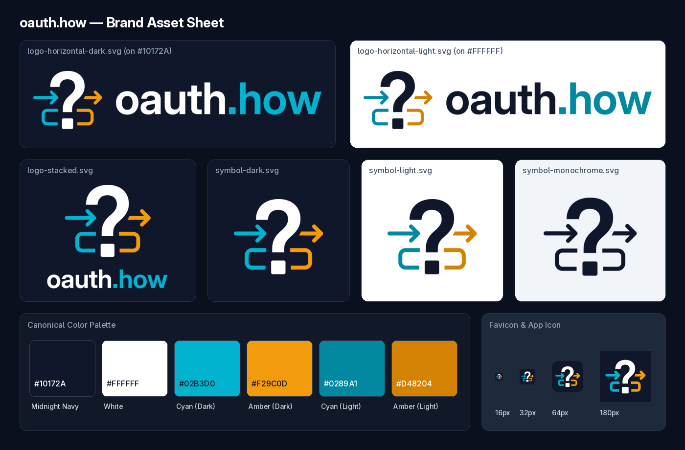
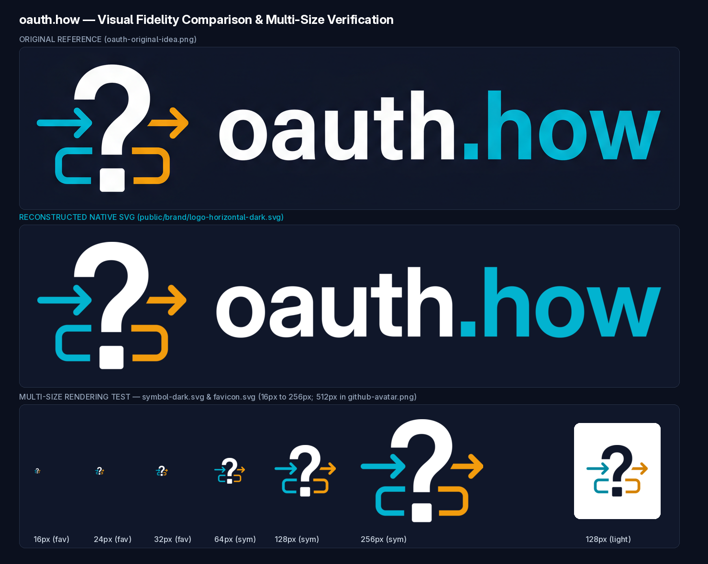

# oauth.how Brand Guidelines & Asset Specification

This document defines the canonical visual identity, vector assets, color system, typography, usage rules, and reproducible build pipeline for **oauth.how**.

All artwork is reconstructed directly from the approved reference (`oauth-original-idea.png`) as clean, native, production-ready SVG vector geometry.



---

## 1. Official Logo & Symbol Variants

All production assets live under `public/` with transparent backgrounds (except favicons and social banners, which use the canonical midnight-navy surface).

### Primary Logos (`public/brand/`)

| File | Description | `viewBox` | Recommended Surface |
| --- | --- | --- | --- |
| [`public/brand/logo-horizontal.svg`](../public/brand/logo-horizontal.svg) | Default full-color horizontal lockup (white + cyan + amber) | `0 0 1560 314` | Dark surfaces |
| [`public/brand/logo-horizontal-dark.svg`](../public/brand/logo-horizontal-dark.svg) | Horizontal lockup explicitly optimized for dark backgrounds | `0 0 1560 314` | Midnight navy (`#10172A`) or dark neutral |
| [`public/brand/logo-horizontal-light.svg`](../public/brand/logo-horizontal-light.svg) | Horizontal lockup with midnight-navy ink and accessible accents | `0 0 1560 314` | White (`#FFFFFF`) or light neutral |
| [`public/brand/logo-stacked.svg`](../public/brand/logo-stacked.svg) | Centered symbol stacked above the `oauth.how` wordmark | `0 0 540 451` | Dark surfaces, square/vertical containers |

### Standalone Symbols (`public/brand/`)

| File | Description | `viewBox` | Recommended Surface |
| --- | --- | --- | --- |
| [`public/brand/symbol.svg`](../public/brand/symbol.svg) | Default full-color standalone question-mark/flow symbol | `0 0 372 314` | Dark surfaces |
| [`public/brand/symbol-dark.svg`](../public/brand/symbol-dark.svg) | Standalone symbol for dark backgrounds | `0 0 372 314` | Dark surfaces |
| [`public/brand/symbol-light.svg`](../public/brand/symbol-light.svg) | Standalone symbol for light backgrounds | `0 0 372 314` | Light surfaces |
| [`public/brand/symbol-monochrome.svg`](../public/brand/symbol-monochrome.svg) | Single-color symbol using `currentColor` (defaults to `#10172A`) | `0 0 372 314` | Any high-contrast monochrome context |

### Favicons & App Icons (`public/`)

| File | Dimensions | Purpose |
| --- | --- | --- |
| [`public/favicon.svg`](../public/favicon.svg) | `64 × 64` vector (`rx="14"`) | Primary scalable browser favicon (heavier flow strokes for 16 px legibility) |
| [`public/favicon-32.png`](../public/favicon-32.png) | `32 × 32` PNG | Standard desktop tab / HiDPI fallback |
| [`public/favicon-16.png`](../public/favicon-16.png) | `16 × 16` PNG | Legacy browser tab fallback |
| [`public/apple-touch-icon.png`](../public/apple-touch-icon.png) | `180 × 180` PNG | iOS / iPadOS home-screen icon (full-bleed navy square for OS squircle mask) |

### Social & Repository Artwork (`public/social/`)

| File | Dimensions | Description |
| --- | --- | --- |
| [`public/social/github-avatar.png`](../public/social/github-avatar.png) | `512 × 512` PNG | Standalone symbol centered on `#10172A` (safe for square & circular crops) |
| [`public/social/og-image.png`](../public/social/og-image.png) | `1200 × 630` PNG | Open Graph social card with centered horizontal logo on `#10172A` |
| [`public/social/social-banner.png`](../public/social/social-banner.png) | `1500 × 500` PNG | Wide 3:1 promotional header banner for GitHub / X / social profiles |

---

## 2. Canonical Color Palette

Colors are sampled directly from the interior flat regions of `oauth-original-idea.png`. Machine-readable design tokens are maintained in [`src/brand/tokens.json`](../src/brand/tokens.json) and [`src/brand/tokens.css`](../src/brand/tokens.css).

| Token | Hex | RGB | HSL | Contrast Ratio | Role |
| --- | --- | --- | --- | --- | --- |
| `--oauth-color-navy` | `#10172A` | `16, 23, 42` | `224°, 45%, 11%` | `17.8:1` vs `#FFFFFF` | Primary dark surface; primary ink on light surfaces |
| `--oauth-color-white` | `#FFFFFF` | `255, 255, 255` | `0°, 0%, 100%` | `17.8:1` vs `#10172A` | Question mark & `oauth` lettering on dark surfaces |
| `--oauth-color-cyan` | `#02B3D0` | `2, 179, 208` | `188°, 98%, 41%` | `7.6:1` vs `#10172A` | Incoming flow (left arrow & bracket) and `.how` on dark surfaces |
| `--oauth-color-amber` | `#F29C0D` | `242, 156, 13` | `37°, 90%, 50%` | `8.5:1` vs `#10172A` | Outgoing flow (right arrow & bracket) on dark surfaces |
| `--oauth-color-cyan-light-surface` | `#0289A1` | `2, 137, 161` | `189°, 98%, 32%` | `4.1:1` vs `#FFFFFF` | Accessible cyan for `.how` & incoming flow on light surfaces |
| `--oauth-color-amber-light-surface` | `#D48204` | `212, 130, 4` | `36°, 96%, 42%` | `3.1:1` vs `#FFFFFF` | Accessible amber for outgoing flow on light surfaces |

- **No gradients**: All brand artwork uses flat, solid fills and strokes.
- **No shadows or glow effects**: Keep contrast clean via surface/foreground pairing.

---

## 3. Typography

- **Primary Wordmark Typeface**: **Inter** (built locally from **Adwaita Sans**, GNOME's distribution of Inter v4, optical size `32`, weight `650`).
- **Wordmark Styling**:
  - Strictly lowercase: `oauth.how`
  - Weight: `650` (SemiBold–Bold optical match to reference)
  - Tracking: `-0.012em`
  - Period (`.`): Geometric square dot matching the reference artwork (converted to a clean vector square in outlined SVGs).
  - Coloring: `oauth` in primary ink (`#FFFFFF` on dark / `#10172A` on light), `.how` in cyan (`#02B3D0` on dark / `#0289A1` on light).
- **Web Fallback Stack**:
  ```css
  font-family: 'Inter', 'Adwaita Sans', -apple-system, BlinkMacSystemFont, 'Segoe UI', Roboto, sans-serif;
  ```
- **Production vs. Editable Source**:
  - All production SVGs in `public/brand/` use **outlined vector `<path>` glyphs** and have **zero external font dependencies**.
  - Editable live-text sources are preserved in [`src/brand/logo-horizontal-editable.svg`](../src/brand/logo-horizontal-editable.svg) and [`src/brand/logo-stacked-editable.svg`](../src/brand/logo-stacked-editable.svg).

### Font Licensing & Attribution

- **Inter** (designed by Rasmus Andersson) and **Adwaita Sans** (based on Inter v4) are licensed under the **SIL Open Font License 1.1 (OFL-1.1)**.
- OFL-1.1 permits commercial and non-commercial use, embedding, outlining into vector artwork, and redistribution without royalty. No visible attribution is required on rendered logos, though preserving the license notice in source repositories is recommended.

---

## 4. Minimum Display Sizes & Clear Space

### Minimum Recommended Sizes

| Asset | Minimum Width | Notes |
| --- | --- | --- |
| `logo-horizontal-*.svg` | `120 px` | Below 120 px, switch to `symbol-*.svg` |
| `logo-stacked.svg` | `72 px` | Preserve vertical readability of `.how` |
| `symbol-*.svg` | `24 px` | Below 24 px, use `favicon.svg` |
| `favicon.svg` | `16 px` | Uses thickened flow strokes (`24` vs `16.5` units) for 16 px clarity |

### Clear Space

- Maintain a minimum clear-space margin equal to **`0.5×` the height of the symbol** (`0.5H`) on all four sides of any logo or standalone symbol.
- Do not crowd the symbol with adjacent text, borders, badges, or competing icons.

---

## 5. Light & Dark Surface Usage

- **Dark backgrounds** (`#10172A` preferred, or any dark neutral with luminance `< 0.08`): use `logo-horizontal-dark.svg`, `logo-stacked.svg`, or `symbol-dark.svg`.
- **Light backgrounds** (`#FFFFFF` or light neutrals `#F8FAFC`–`#F1F5F9`): use `logo-horizontal-light.svg` or `symbol-light.svg`. These swap white ink to `#10172A` and deepen cyan/amber slightly (`#0289A1` / `#D48204`) to maintain WCAG AA contrast on white.
- **Monochrome / single-color contexts** (watermarks, print stamps, UI toolbars): use `symbol-monochrome.svg` and control color via CSS `color`.

---

## 6. Favicon HTML Integration

```html
<link rel="icon" href="/favicon.svg" type="image/svg+xml" />
<link rel="icon" href="/favicon-32.png" sizes="32x32" type="image/png" />
<link rel="icon" href="/favicon-16.png" sizes="16x16" type="image/png" />
<link rel="apple-touch-icon" href="/apple-touch-icon.png" sizes="180x180" />
<meta name="theme-color" content="#10172A" />
```

---

## 7. SVG Optimization & Quality Rules

All production SVGs follow these standards:

1. **Native primitives only**: `<path>`, `<rect>`, and `<g>` with clean fills/strokes.
2. **No embedded rasters or base64 data**: Zero `<image>` elements.
3. **No external font dependencies**: Wordmarks in `public/brand/` are converted to exact Bezier `<path>` outlines.
4. **No filters, shadows, or blend modes**: Pure flat vector geometry for universal browser compatibility.
5. **Tightly fitted `viewBox`**: No unnecessary whitespace or hardcoded pixel `width`/`height` attributes on scalable brand SVGs.
6. **Readable & maintainable**: Structured semantic groups (`#symbol`, `#wordmark`, `#wordmark-oauth`, `#wordmark-how`) with 2-decimal precision.

---

## 8. Visual Verification & Documented Refinements



Every asset was rendered and visually compared against `oauth-original-idea.png` across `16 px`, `24 px`, `32 px`, `64 px`, `128 px`, `256 px`, and `512 px` (`github-avatar.png`).

### Documented Refinements vs. Reference

- **Exact geometric symmetry**: The left cyan bracket and right amber bracket share identical stroke width (`16.5` units), corner radius (`22` units), vertical bounds, and symmetric `25`-unit clearance from the question-mark stem (the reference PNG had a ~2 px asymmetry on the right bracket).
- **Uniform flow stroke weight**: Both arrows and both brackets use a single canonical stroke width (`16.5` units) with matching 45° rounded chevrons.
- **Light-surface accessible accents**: `*-light.svg` variants deepen cyan (`#0289A1`) and amber (`#D48204`) to meet WCAG AA contrast on `#FFFFFF` while preserving exact hue identity.
- **Favicon stroke weight**: `public/favicon.svg` increases flow stroke width (`16.5` → `24` units on the 372-unit symbol grid) so arrows and brackets stay legible at `16 × 16` px.

---

## 9. Asset Regeneration Instructions

All assets in `public/` and verification sheets in `docs/` are generated deterministically by a single script with no external network services or heavyweight packages:

```bash
/usr/bin/python3 src/brand/build_brand_assets.py
```

**Requirements**:
- Python 3 with Pillow (`PIL`) and NumPy
- System FreeType (`libfreetype.so.6`)
- ImageMagick (`magick`) with `librsvg` support
- Inter / Adwaita Sans variable font (`/usr/share/fonts/adwaita-sans-fonts/AdwaitaSans-Regular.ttf`)

To adjust colors, spacing, or typography, update [`src/brand/tokens.json`](../src/brand/tokens.json), [`src/brand/tokens.css`](../src/brand/tokens.css), and [`src/brand/build_brand_assets.py`](../src/brand/build_brand_assets.py), then re-run the script and inspect `docs/comparison-sheet.png` and `docs/brand-sheet.png`.
